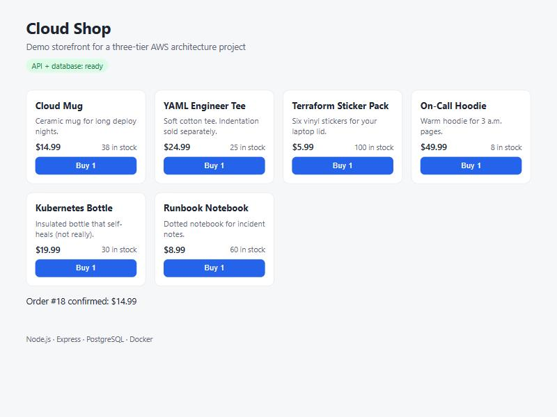
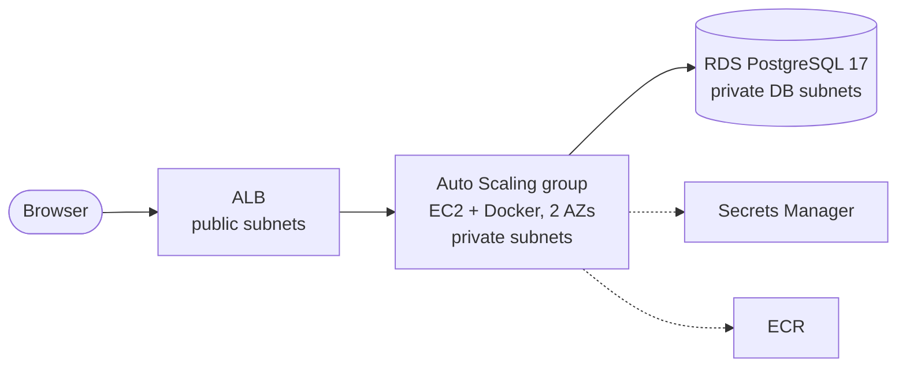

# AWS Multi-Region E-Commerce Platform

> A three-tier Node.js + PostgreSQL store, built to show how a cloud engineer
> designs for availability, disaster recovery, and safe automated deployments on AWS.

> **Status: work in progress.** The application runs and is tested locally.
> The AWS infrastructure is not deployed yet. Every ✅ below links to real evidence in
> [`docs/evidence/`](docs/evidence/).



## Project status

| Capability | Status | Evidence |
|---|---|---|
| Node.js API + PostgreSQL (local, Docker Compose) | ✅ Implemented & verified locally | [compose-ps.txt](docs/evidence/compose-ps.txt), screenshot above |
| Unit tests (20) and integration tests against real PostgreSQL (8) | ✅ Passing locally | [evidence log](docs/evidence/README.md) |
| Oversell protection under concurrent orders | ✅ Tested, plus a negative-control experiment | [Experiment 1](docs/evidence/README.md#experiment-1-does-the-concurrency-test-actually-detect-overselling) |
| Graceful shutdown on SIGTERM | ✅ Tested locally | [Experiment 2](docs/evidence/README.md#experiment-2-graceful-shutdown-on-sigterm) |
| Terraform modules (VPC, ALB, ASG, RDS), statically validated, **not deployed** | ✅ Validated | [terraform-validate.txt](docs/evidence/terraform-validate.txt), [architecture](docs/architecture.md) |
| IaC security scan (Trivy): 0 unaccepted HIGH/CRITICAL findings | ✅ Scanned | [trivy-scan.txt](docs/evidence/trivy-scan.txt), [triage](docs/architecture.md#security-scan-triage) |
| GitHub Actions CI | ⏳ Planned | — |
| AWS deployment (us-east-1) | 🗺️ Future | — |
| Cross-region DR (us-west-2) + Route 53 failover | 🗺️ Future | — |

**Legend:** ✅ implemented & verified · 🧪 simulated locally · ⏳ planned for this phase · 🗺️ future enhancement

## AWS architecture (designed, not deployed)



The Terraform in [`terraform/`](terraform/) describes this stack in four modules (network,
security, database, app). It passes `terraform validate` and a Trivy security scan, but it
has **not been applied to AWS**. The full design (security model, design decisions,
disaster-recovery plan, and **cost estimate of roughly $0.13/hour while running**) is in
[docs/architecture.md](docs/architecture.md).

```bash
cd terraform/envs/dev
terraform init -backend=false
terraform validate        # static check only; creates nothing, needs no AWS account
```

## What the application does

| Endpoint | Purpose |
|---|---|
| `GET /` | Demo storefront (static HTML + JS) |
| `GET /health` | **Liveness:** is the process running? Never touches the database. |
| `GET /ready` | **Readiness:** can this instance serve traffic? Checks the database and returns `503` while shutting down. |
| `GET /api/products` | List products |
| `GET /api/products/:id` | One product |
| `POST /api/orders` | Place an order in a single database transaction |
| `GET /api/orders/:id` | An order with its line items |

### Design decisions

- **Money is stored as integer cents**, never floating point, to avoid rounding errors.
- **Orders are all-or-nothing.** Stock is checked and reduced in one transaction, so a
  failed order changes nothing.
- **No overselling under concurrency.** Product rows are locked (`SELECT ... FOR UPDATE`)
  in a consistent order, which also avoids deadlocks. A `CHECK (stock >= 0)` constraint
  is a second safety net.
- **Separate liveness and readiness checks.** A database outage should take instances
  out of rotation (readiness), not cause healthy app servers to be killed and replaced (liveness).
- **Graceful shutdown.** On `SIGTERM` the app stops reporting ready, finishes in-flight
  requests, and closes database connections. This is required for zero-downtime deploys.
- **Migrations are safe with many instances.** A PostgreSQL advisory lock ensures only one
  instance applies schema changes when several start at once (e.g. an Auto Scaling group).
- **Configuration comes from environment variables**, with no secrets in code. Locally they
  come from a git-ignored `.env`; in AWS they would come from Secrets Manager.
- **Structured JSON logs with request ids**, ready for CloudWatch Logs queries.
- **Container hardening:** multi-stage build, production dependencies only, runs as the
  non-root `node` user, Docker `HEALTHCHECK`, ports bound to `127.0.0.1` only.

## Run it locally

**Prerequisites:** Docker Desktop and Node.js 24+ (Node is only needed to run the tests).

```bash
# 1. Create your local settings file (git-ignored)
cp .env.example .env              # PowerShell: Copy-Item .env.example .env

# 2. Build and start the database + app
docker compose up -d --build

# 3. Open the storefront
#    http://localhost:8080
```

If port 8080 or 5433 is already taken on your machine, change `APP_PORT` or `PGPORT` in `.env`.

### Run the tests

```bash
cd app
npm ci
npm test                    # unit tests (no database needed)
npm run test:integration    # needs the database: docker compose up -d db
npm run lint
```

### Stop and clean up

```bash
docker compose down         # stop containers, keep database data
docker compose down -v      # also delete the database volume
```

## Repository layout

```
.
├── app/
│   ├── src/            # Express app, routes, DB pool, migrations runner, logger
│   ├── migrations/     # SQL schema and seed data, applied in filename order
│   ├── public/         # Demo storefront
│   ├── test/unit/      # Fast tests with a fake database
│   ├── test/integration/  # Tests against real PostgreSQL
│   └── Dockerfile
├── terraform/
│   ├── modules/        # network, security, database, app (reusable)
│   └── envs/dev/       # dev environment wiring the modules together
├── docker-compose.yml  # Local three-tier stack
└── docs/evidence/      # Real test output, screenshots, experiment results
```

## Known limitations (current phase)

- Runs locally only; no AWS resources exist yet.
- No authentication: any caller can place an order. This is acceptable for a demo,
  but not for a real shop.
- No payment processing; orders are confirmed immediately.
- The single PostgreSQL container is a single point of failure. High availability is
  the goal of the AWS phase (RDS Multi-AZ, multiple app instances behind a load balancer).

## License

[MIT](LICENSE)
