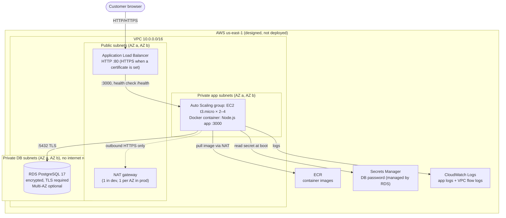
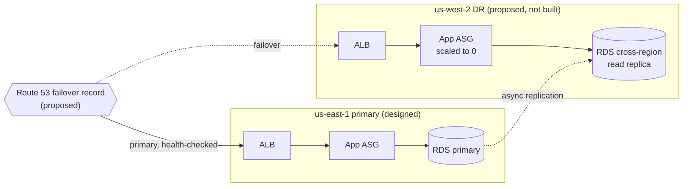

# Architecture

> **Status of everything on this page: designed and statically validated, NOT deployed.**
> The Terraform passes `terraform validate`, `terraform fmt -check`, and a Trivy security
> scan ([evidence](evidence/)). No AWS resources have been created, so nothing here has a
> measured uptime, failover time, or cost.

## 1. Problem statement

An online shop must keep taking orders when a single server, or a whole data centre
(Availability Zone), fails. It must deploy new versions without downtime, and it must be
possible to recover in another AWS region after a regional outage. All of this should be
reproducible from code, not built by hand.

## 2. Requirements and success criteria

| Requirement | How the design meets it | Verified? |
|---|---|---|
| Survive the loss of one app server | Auto Scaling group (min 2) behind a load balancer; failed health checks trigger replacement | Not yet (needs deployment) |
| Survive the loss of one Availability Zone | Subnets, app servers, and (optionally) RDS Multi-AZ across 2 AZs | Not yet |
| No overselling under concurrent orders | DB transaction with row locks | ✅ Locally ([integration tests](evidence/integration-tests.txt)) |
| Zero-downtime deploys | Rolling instance refresh (min 50% healthy), 30 s connection draining, graceful SIGTERM shutdown | Shutdown ✅ locally; rolling refresh not yet |
| No secrets in code or Terraform state | RDS-managed password in Secrets Manager, read at boot by an IAM role | Design only |
| Least-privilege network access | Security groups: internet → ALB → app → DB only | Static scan ✅ |
| Reproducible infrastructure | Terraform modules; versions pinned in `.terraform.lock.hcl` | `validate` ✅ |

## 3. Architecture (primary region, designed)



### What each component does (plain English)

| Component | Role | Why it is there |
|---|---|---|
| **VPC** | Your private network inside AWS | Isolates the shop from other AWS customers |
| **Public subnets** | The only part reachable from the internet | Holds just the load balancer and NAT gateway |
| **Private app subnets** | Where app servers run; no public IPs | Servers cannot be attacked directly from the internet |
| **Private DB subnets** | Where the database runs; no internet route at all | The most sensitive data gets the most isolation |
| **Application Load Balancer** | Spreads requests across healthy servers | Removes single-server failure; health-checks every 15 s |
| **Auto Scaling group** | Keeps 2–4 servers running across AZs | Replaces failed servers; adds servers when CPU > 50% |
| **NAT gateway** | Lets private servers make outbound calls | Needed to pull images and read secrets. Inbound is impossible |
| **RDS PostgreSQL** | Managed database with automated backups | AWS handles patching, backups, and optional Multi-AZ failover |
| **Secrets Manager** | Stores the database password | RDS generates and rotates it; it never appears in code or state |
| **ECR** | Private container registry | Images are scanned on push; tags are immutable |
| **CloudWatch Logs** | Central log storage | App logs plus rejected-traffic flow logs, kept 14 days |
| **IAM role (instance profile)** | The app servers' identity | Grants only: read one secret, pull one repository, write one log group, Session Manager |

## 4. Request flow

1. The browser connects to the load balancer's DNS name on port 80 (443 with a certificate).
2. The load balancer picks a healthy instance and forwards the request to port 3000.
3. The Node.js app validates the request and queries RDS over TLS
   (`PGSSLMODE=verify-full`, verified against Amazon's RDS CA bundle).
4. The response returns through the load balancer. The app writes one JSON log line to CloudWatch.

**At boot**, each instance runs [`user_data.sh.tftpl`](../terraform/modules/app/user_data.sh.tftpl):

1. Installs Docker.
2. Downloads the RDS CA bundle.
3. Reads the database credentials from Secrets Manager.
4. Writes them to a root-only file.
5. Logs in to ECR and starts the container.

The first instance to boot runs the database migrations; the others wait on the advisory lock.

## 5. Security model

| Layer | Control |
|---|---|
| Network | Three subnet tiers; security groups chained by group ID (ALB → app → DB); DB has no egress and no internet route |
| Identity | One IAM role per tier with resource-scoped permissions; no SSH keys (Session Manager instead) |
| Secrets | `manage_master_user_password = true`: the password lives only in Secrets Manager |
| Encryption at rest | RDS storage, EBS volumes, and ECR are encrypted (AWS-managed keys) |
| Encryption in transit | DB connections require TLS (`rds.force_ssl = 1`); HTTPS on the ALB when a certificate is provided |
| Instance hardening | IMDSv2 required, hop limit 1 (containers cannot reach instance credentials) |
| Detection | VPC Flow Logs (rejected traffic); ECR scan on push |
| Supply chain | Provider versions locked; immutable image tags |

### Security scan triage

Trivy 0.76.1 ([raw output](evidence/trivy-scan.txt)). The CI gate fails on any HIGH or
CRITICAL finding that is not explicitly accepted below.

| Finding | Severity | Decision | Reason |
|---|---|---|---|
| AWS-0104: HTTP (port 80) egress to the internet | CRITICAL | **Fixed** | Removed. Amazon Linux 2023 package repositories use HTTPS. |
| AWS-0178: no VPC Flow Logs | MEDIUM | **Fixed** | Added, capturing REJECT traffic to CloudWatch (14-day retention). |
| AWS-0104: HTTPS (443) egress to the internet | CRITICAL | Accepted (inline `trivy:ignore`) | AWS API endpoints use changing public IPs. Alternative: VPC interface endpoints, billed per endpoint per AZ. |
| AWS-0053: internet-facing load balancer | HIGH | Accepted (inline) | It is a public storefront. Access can be narrowed with `allowed_ingress_cidrs`. |
| AWS-0054: plain HTTP listener | CRITICAL | Accepted for demo (inline) | No domain means no ACM certificate. Setting `certificate_arn` switches HTTP to an HTTPS redirect. |
| AWS-0177: RDS deletion protection off | MEDIUM | Accepted for dev | The module default is `true`; dev disables it so the environment can be torn down. |
| AWS-0176: no IAM database authentication | MEDIUM | Future improvement | Password auth via Secrets Manager for now. |
| AWS-0033, AWS-0017: AWS-managed instead of customer-managed KMS keys | LOW | Accepted | Encryption is on; customer keys add cost and key-management work. |
| AWS-0133: Performance Insights off | LOW | Accepted | Not needed at this scale. |

## 6. Key design decisions

**The load balancer health check uses `/health`, not `/ready`.**
An ALB target group has one health check. Because the Auto Scaling group uses ELB health
checks, that same check decides whether instances get *replaced*. If it pointed at `/ready`
(which queries the database), a database outage would mark every instance unhealthy. Auto
Scaling would then terminate and relaunch the whole fleet, which fixes nothing and adds
load. So the ALB uses the shallow `/health`, and `/ready` is used where a separate readiness
signal exists (Docker locally, Kubernetes in Project 2).

**EC2 + Docker instead of ECS or EKS.**
It keeps every layer visible and explainable: networking, boot scripts, IAM, scaling. ECS
Fargate would remove instance management and is the natural next step.

**One NAT gateway in dev, one per AZ in production.**
A NAT gateway costs money every hour. One shared NAT means losing its AZ cuts outbound
access for both AZs (the app keeps serving, but new instances cannot pull images).
`single_nat_gateway = false` removes that dependency.

**RDS-managed master password.**
Terraform never sees the password, so it cannot leak through state files.

**Rolling instance refresh rather than blue/green (for now).**
Changing the image tag creates a new launch template version. Auto Scaling then replaces
instances gradually, keeping at least 50% healthy. True blue/green (two target groups and
a listener switch) is listed under future work.

**Known simplification:** the app connects as the RDS master user. A production setup would
create a separate least-privilege database user for the application.

## 7. Disaster recovery (designed only, not implemented)

Proposed approach, in order of cost:

| Strategy | How | Est. RPO / RTO (design targets, unmeasured) |
|---|---|---|
| Backup & restore | Copy automated RDS snapshots to us-west-2; run the same Terraform with `region = "us-west-2"` on demand | Hours / hours |
| Pilot light *(proposed target)* | Cross-region RDS read replica always running in us-west-2; app tier scaled to 0 there; Route 53 failover record with health checks on the primary ALB | Minutes / tens of minutes |
| Warm standby | As pilot light, plus a small app fleet already running in us-west-2 | Minutes / minutes |

**RPO** (Recovery Point Objective) is how much recent data you can afford to lose.
**RTO** (Recovery Time Objective) is how long you can afford to be down. These are
*targets*. Real values only exist after a timed failover exercise, which is planned
once the stack is deployed.



## 8. Cost estimate (ESTIMATE, not billing data)

Approximate **us-east-1 on-demand** prices from public AWS pricing as I understand them.
They change over time, so **check the [AWS Pricing Calculator](https://calculator.aws/)
before deploying.** Free-tier credits are ignored.

| Resource (dev defaults) | Billed while idle? | Approx. per hour | Approx. per month (730 h) |
|---|---|---|---|
| NAT gateway ×1 | **Yes** | $0.045 + data | ~$33 |
| Application Load Balancer | **Yes** | ~$0.0225 + usage | ~$17 |
| EC2 t3.micro ×2 | **Yes** | ~$0.0104 each | ~$15 |
| RDS db.t4g.micro, single-AZ | **Yes** | ~$0.016 | ~$12 (Multi-AZ about 2×) |
| Public IPv4 addresses (NAT + ALB) ×3 | **Yes** | $0.005 each | ~$11 |
| EBS + RDS storage (60 GB gp3) | **Yes** | — | ~$6 |
| Secrets Manager, CloudWatch, ECR | Mostly per use | — | ~$1–3 |
| **Total (rough)** | | **~$0.13/hour** | **~$95/month** |

**Implication:** this stack should **not** be left running. The intended use is a
time-boxed experiment: deploy, capture evidence, destroy. A 2-hour test is roughly
$0.30–$0.50 (estimate). Actual cost will be recorded from AWS Billing after any deployment.

## 9. Teardown and resource inventory (for a future deployment)

```bash
cd terraform/envs/dev
terraform destroy          # review the plan, type "yes"
```

Then confirm nothing is left (all resources carry the tag `Project=aws-multi-region-ecommerce`):

```bash
aws resourcegroupstaggingapi get-resources --tag-filters Key=Project,Values=aws-multi-region-ecommerce --region us-east-1
```

Items that can outlive `terraform destroy` and still cost money:

- The Secrets Manager secret, which RDS schedules for deletion.
- Any manual RDS snapshots.
- CloudWatch log groups created by AWS services outside Terraform.

## 10. Limitations and future work

- **Not deployed:** no measured availability, failover, or cost data yet.
- HTTP only until a domain and ACM certificate are added.
- The app uses the RDS master user; it should have its own least-privilege DB user.
- Migrations run at instance boot; a separate pipeline step would be safer.
- No WAF, no rate limiting, no authentication.
- No metrics-based alarms yet (ALB 5xx, target health, RDS CPU/storage).
- Blue/green deployments and cross-region DR are designed only.
- Terraform state is local; the S3 backend with locking is ready to enable.
